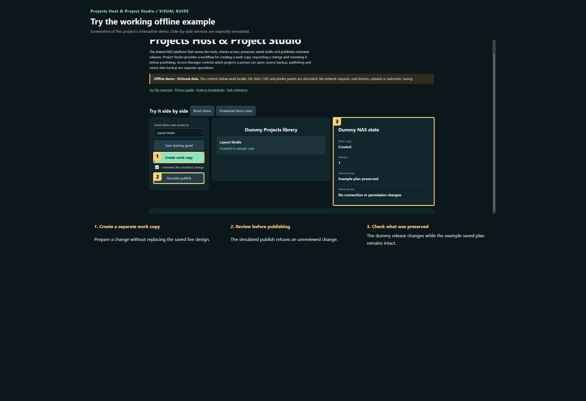

# Projects Host & Project Studio

**Maintaining this project? [Start here](docs/START-HERE.md) · [Detailed handover](docs/HANDOVER.md)**

The shared NAS platform that serves the tools, checks access, preserves saved drafts and publishes reviewed releases. Project Studio provides a workflow for creating a work copy, requesting a change and reviewing it before publishing. Access Manager controls which projects a person can open; source backup, publishing and saved-data backup are separate operations.

**Private preview · not published.**

[Open the visual manual](docs/USER-MANUAL.md) · [Download the self-contained demo](demo.html) · [Release notes](CHANGELOG.md)

Download `demo.html` using GitHub’s Download raw file control, then open it in your browser. GitHub displays HTML source; it does not run the demo on this page. The demo is an offline simulation with fictional data and makes no network requests.

## See it

### Try the working offline example

Screenshot of this project’s interactive demo. Side-by-side services are explicitly simulated.

1. **Create a separate work copy.** Prepare a change without replacing the saved live design.
2. **Review before publishing.** The simulated publish refuses an unreviewed change.
3. **Check what was preserved.** The dummy release changes while the example saved plan remains intact.

## What this tool does

| Feature | What it lets you do | Where |
| --- | --- | --- |
| Project library | Search/filter tools, read previews and open dedicated project pages. | NAS platform |
| Access Manager | Owner-managed per-project grants behind authenticated sign-in. | NAS platform |
| Project Studio | Create a separate work copy, request changes and review before publishing. | NAS platform |
| Saved drafts | Persist shared app designs on the NAS independently of the Windows PC. | NAS platform |
| Release workflow | Curate files, validate, sign, deploy and verify a release with rollback on failed startup. | NAS platform |
| History and restores | Owner-only version history and deliberate restoration workflow. | NAS platform |
| App services | Gateway routes to HA, CAD, plant, QR backup and other protected services. | NAS platform |

## A first useful workflow

### Find and open a tool

1. Use search or category filters in the project library. Open Preview to see what a tool does; Open tool goes to the actual application.
2. Only projects granted to the signed-in account are shown. An owner-only tool is not shared by simply copying its URL.
3. Use the project’s own save status and export options; the library overview itself does not save its designs.

## Saving and outputs

Source lives in Git; saved designs and service data live on the NAS; credentials stay in protected configuration. Maintain independent recovery copies of each required category. The public release allowlist must not contain private configuration, logs, credentials, SDKs or unrelated projects.

## Running the actual tool

Use the configured NAS platform; demo.html has no connection to it.

The demo has no prerequisites; the real tool may need the services described in the manual and retained source notes.

## Current boundaries

This is installation-specific infrastructure and remains private. A portable public edition needs a configuration/authentication guide and clean deployment testing. The demo changes only mock permissions, work copies and release state.

## Licence and sharing

MIT applies to original project contributions. Bundled/upstream software and assets retain their own terms; see [third-party notes](THIRD-PARTY.md). Keep this repository private until its own [release checklist](RELEASE-CHECKLIST.md) is complete and the owner authorises publication.
